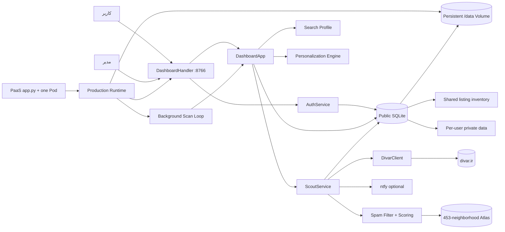
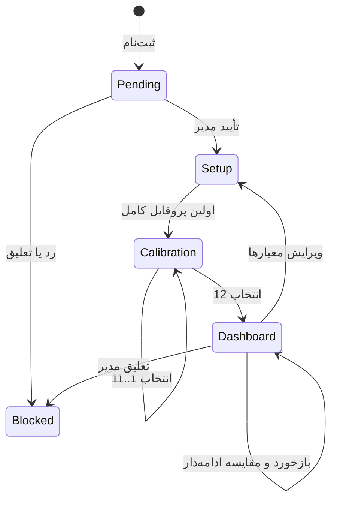
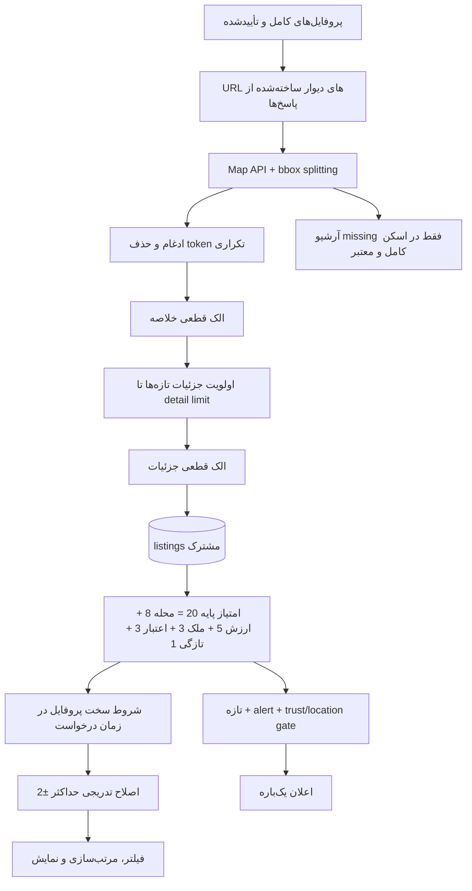
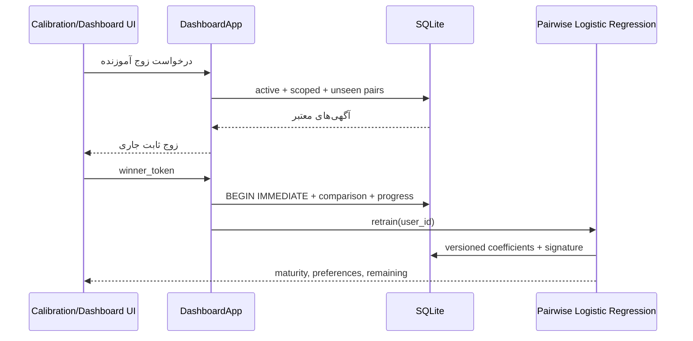
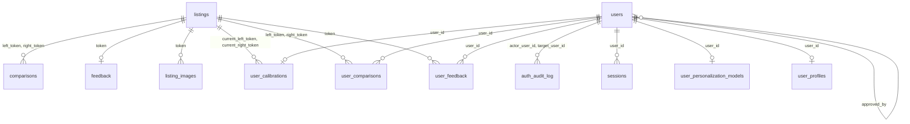

# معماری خانه‌یاب عمومی

> این سند خودکار از کد واقعی تولید شده است. منبع ویرایش `scripts/update_architecture.py` است.  
> اثرانگشت ورودی‌های معماری: `16e865369bfa783b`

## روش استفاده برای توسعه

1. پیش از تغییر، این سند و سپس فقط ماژول‌های مرتبط را بخوان.
2. `python scripts/update_architecture.py --check` فایل‌های معماری تغییرکرده را مشخص می‌کند.
3. پس از تغییر قرارداد یا جریان، Mermaidهای مرجع را در generator بازبینی کن.
4. `--write` را اجرا کن، خروجی را بخوان و بعد کل تست‌ها را اجرا کن.

## مرز سیستم



- ریشه نوشتن فقط همین پروژه است؛ پروژه شخصی والد و پورت `8765` خارج از محدوده‌اند.
- اجرای محلی روی `127.0.0.1:8766` و اجرای PaaS روی `0.0.0.0:8766` است.
- production دقیقاً یک Pod و یک SQLite در `/data` دارد؛ چند Pod نیازمند PostgreSQL است.
- آگهی‌ها مشترک‌اند؛ پروفایل، feedback، comparison، calibration و model با `user_id` جدا می‌شوند.

## چرخه کاربر



- onboarding دقیقاً ۱۲ پاسخ و بدون skip است؛ زوج جاری پایدار و ثبت پاسخ اتمیک است.
- شروع اثر شخصی‌سازی در ۱۲ سیگنال و قدرت کامل در ۴۰ سیگنال است.
- کاربران کامل‌شده پیش از افزودن calibration، به‌علت نداشتن رکورد `user_calibrations` قفل نمی‌شوند.

## جریان اسکن و رتبه‌بندی



- spam پیش از «همه»، آمار، مقایسه و اعلان حذف می‌شود.
- شخصی‌سازی نمی‌تواند رد سخت، بودجه نهایی، محله انتخابی یا الزامات امکانات را نجات دهد.
- آگهی منقضی غیرفعال می‌شود؛ تاریخچه برای یادگیری باقی می‌ماند.
- نسخه عمومی AI تصویری ندارد.

## جریان یادگیری



## نقشه ماژول‌ها

| ماژول | مسئولیت | ورودی‌های اصلی |
|---|---|---|
| `__init__.py` | مرز پکیج عمومی | `-` |
| `__main__.py` | ورودی اجرای `python -m divar_scout` | `-` |
| `auth.py` | حساب، رمز scrypt، نشست، CSRF، تأیید مدیر و ممیزی | `AuthError, RateLimitError, AuthUser, AuthSession, normalize_username, validate_username` |
| `cli.py` | فرمان‌های dashboard، scan، watch، admin-create و اعلان | `build_parser, main` |
| `config.py` | بارگذاری و اعتبارسنجی تنظیمات مستقل عمومی | `AppConfig, load_config, database_path` |
| `dashboard.py` | Application service، HTTP routes، گیت‌های دسترسی و API | `DashboardApp, DashboardHandler, DashboardServer, serve` |
| `db.py` | Schema و تمام عملیات پایدار SQLite | `utc_now, image_fingerprint, Database` |
| `divar_client.py` | دریافت map/detail دیوار، تقسیم bbox و parsing شبکه | `normalize_digits, parse_integer, parse_money, jalali_to_gregorian, extract_listing_dates, build_map_payload` |
| `models.py` | قراردادهای Listing و ScoreResult | `Listing, ScoreResult` |
| `neighborhoods.py` | بانک ثابت ۴۵۳ محله، normalization و lookup امتیاز | `normalize_text, NeighborhoodRating, NeighborhoodAtlas, default_atlas` |
| `notifier.py` | ارسال اعلان اختیاری ntfy | `NtfyNotifier, format_money` |
| `personalization.py` | مدل pairwise محلی و انتخاب مقایسه آموزنده | `PersonalizationEngine` |
| `runtime.py` | ورودی production، Volume، ادمین bootstrap و اسکن پس‌زمینه PaaS | `environment_flag, validate_paas_runtime, bootstrap_admin, scan_forever, run_paas` |
| `scoring.py` | الک قطعی، شروط سخت و امتیاز پایه از ۲۰ | `listing_exclusion_reason, profile_scope_exclusion_reason, score_listing` |
| `search_profile.py` | اعتبارسنجی پاسخ‌ها و ساخت جست‌وجوی دیوار برای پروفایل | `SearchProfileError, districts, district_catalog, empty_profile, normalize_profile, validate_profile` |
| `service.py` | هماهنگ‌کننده اسکن، جزئیات، آرشیو، امتیاز و اعلان | `ScanResult, ScoutService, merge_summary` |

## صفحات اصلی

| صفحه | مسئولیت |
|---|---|
| `admin.html` | مدیریت و تأیید حساب‌ها (`admin.js`) |
| `auth.html` | ورود و ثبت‌نام (`auth.js`) |
| `calibration.html` | ۱۲ مقایسه آغازین اجباری (`calibration.js`) |
| `index.html` | داشبورد نتایج و یادگیری ادامه‌دار (`app.js`) |
| `pending.html` | انتظار، رد یا تعلیق حساب (`pending.js`) |
| `setup.html` | ویزارد معیارها و انتخاب محله (`setup.js`) |

## Routeهای واقعی

این جدول از AST متدهای `do_GET` و `do_POST` ساخته شده است؛ Route بدون توضیح تولید سند را متوقف می‌کند.

| روش | مسیر | مسئولیت | دسترسی |
|---|---|---|---|
| `GET` | `/` | داشبورد یا هدایت به مرحله لازم | `approved + profile + calibration` |
| `GET` | `/admin` | پنل مدیریت | `admin` |
| `GET` | `/api/admin/users` | فهرست و آمار حساب‌ها | `admin` |
| `POST` | `/api/admin/users/status` | تأیید، رد یا تعلیق | `admin + CSRF` |
| `POST` | `/api/auth/login` | ساخت نشست | `guest` |
| `POST` | `/api/auth/logout` | ابطال نشست | `authenticated + CSRF` |
| `GET` | `/api/auth/me` | وضعیت نشست و CSRF | `session optional` |
| `POST` | `/api/auth/password` | تغییر رمز و ابطال نشست | `authenticated + CSRF` |
| `POST` | `/api/auth/register` | ساخت حساب pending | `guest` |
| `GET` | `/api/calibration` | زوج ثابت بعدی و پیشرفت | `profile required` |
| `POST` | `/api/calibration` | ثبت اتمیک یک انتخاب | `profile required + CSRF` |
| `GET` | `/api/comparison` | مقایسه ادامه‌دار داشبورد | `calibration complete` |
| `POST` | `/api/comparison` | ثبت مقایسه ادامه‌دار | `calibration complete + CSRF` |
| `GET` | `/api/config` | تنظیمات امن کاربر | `calibration complete` |
| `POST` | `/api/feedback` | ثبت بازخورد آگهی | `calibration complete + CSRF` |
| `GET` | `/api/learning` | وضعیت موتور سلیقه | `calibration complete` |
| `GET` | `/api/listings` | نتایج شخصی‌شده | `calibration complete` |
| `POST` | `/api/notify-test` | اعلان سراسری آزمایشی | `admin + CSRF` |
| `POST` | `/api/personalization/reset` | پاک‌کردن یادگیری همان کاربر | `calibration complete + CSRF` |
| `GET` | `/api/profile` | پروفایل و کاتالوگ محله | `approved` |
| `POST` | `/api/profile` | ثبت پروفایل و شروع onboarding تازه | `approved + CSRF` |
| `POST` | `/api/scan` | تازه‌سازی موجودی مشترک | `profile required + CSRF` |
| `GET` | `/api/stats` | آمار داشبورد | `calibration complete` |
| `GET` | `/assets/*` | فایل‌های استاتیک همان پروژه | `public asset` |
| `GET` | `/calibration` | مرحله ۱۲ مقایسه | `approved + profile + required` |
| `GET` | `/healthz` | سلامت پردازش عمومی | `public` |
| `GET` | `/login` | صفحه ورود | `guest` |
| `GET` | `/pending` | وضعیت حساب تأییدنشده | `authenticated` |
| `GET` | `/register` | صفحه ثبت‌نام | `guest` |
| `GET` | `/setup` | ویزارد پروفایل جست‌وجو | `approved user` |

## مدل داده واقعی



| جدول | مسئولیت | کلید | ستون‌ها | ارتباط‌ها |
|---|---|---|---|---|
| `auth_attempts` | محدودسازی تلاش ورود | `id` | `id, username, remote_address, succeeded, created_at` | `-` |
| `auth_audit_log` | ممیزی تغییرات امنیتی | `id` | `id, actor_user_id, action, target_user_id, remote_address, details_json, created_at` | `target_user_id→users.id, actor_user_id→users.id` |
| `comparisons` | مقایسه legacy سراسری | `id` | `id, left_token, right_token, winner_token, kind, reasons_json, created_at` | `right_token→listings.token, left_token→listings.token` |
| `feedback` | بازخورد legacy سراسری | `token` | `token, choice, reasons_json, created_at, updated_at` | `token→listings.token` |
| `listing_images` | اثر انگشت عکس برای تشخیص تکرار | `token, fingerprint` | `token, fingerprint` | `token→listings.token` |
| `listings` | موجودی مشترک آگهی و امتیاز پایه | `token` | `token, title, district, url, listing_json, score_json, total_score, status, detail_fetched_at, first_seen_at, last_seen_at, notified_at, notification_eligible, is_active, expired_at, filtered_at, filter_reason` | `-` |
| `personalization_model` | مدل legacy سراسری | `id` | `id, model_json, trained_at, training_signature` | `-` |
| `scans` | تاریخچه و نتیجه اسکن‌ها | `id` | `id, started_at, finished_at, summary_count, detail_count, expired_count, filtered_count, error` | `-` |
| `sessions` | نشست‌های امن کاربران | `token_hash` | `token_hash, user_id, csrf_token, created_at, expires_at, last_seen_at, user_agent, remote_address` | `user_id→users.id` |
| `user_calibrations` | پیشرفت و زوج جاری onboarding | `user_id` | `user_id, target_count, completed_count, current_left_token, current_right_token, started_at, completed_at, updated_at` | `current_right_token→listings.token, current_left_token→listings.token, user_id→users.id` |
| `user_comparisons` | مقایسه‌های خصوصی هر کاربر | `id` | `id, user_id, left_token, right_token, winner_token, kind, reasons_json, created_at` | `right_token→listings.token, left_token→listings.token, user_id→users.id` |
| `user_feedback` | بازخورد خصوصی هر کاربر | `user_id, token` | `user_id, token, choice, reasons_json, created_at, updated_at` | `token→listings.token, user_id→users.id` |
| `user_personalization_models` | مدل خصوصی نسخه‌بندی‌شده | `user_id` | `user_id, model_json, trained_at, training_signature` | `user_id→users.id` |
| `user_profiles` | معیارها و محدوده جست‌وجوی کاربر | `user_id` | `user_id, search_url, profile_json, created_at, updated_at` | `user_id→users.id` |
| `users` | هویت، نقش و وضعیت تأیید | `id` | `id, username, display_name, password_hash, role, status, created_at, updated_at, approved_at, approved_by, last_login_at` | `approved_by→users.id` |

## راهنمای اثر تغییر

| حوزه تغییر | نقطه شروع | تست‌های اصلی | کنترل تکمیلی |
|---|---|---|---|
| حساب و تأیید | `auth.py`, `dashboard.py`, `db.py` | `test_auth.py` | CSRF، ابطال نشست، route gate |
| معیار و محله | `search_profile.py`, `setup.*`, neighborhood data | `test_search_profile.py`, `test_scoring.py` | لیست و نقشه موبایل/دسکتاپ |
| crawler و انقضا | `divar_client.py`, `service.py`, `db.py` | `test_parser.py`, `test_service.py` | scan ناقص نباید archive جمعی کند |
| spam و امتیاز | `scoring.py`, `neighborhoods.py` | `test_scoring.py`, `test_dashboard.py` | «همه»، آمار و comparison باید پاک باشند |
| سلیقه و onboarding | `personalization.py`, `dashboard.py`, `db.py`, `calibration.*` | `test_personalization.py`, `test_calibration.py` | ۱۲ انتخاب، replay، refresh و redirect |
| داشبورد و sort | `app.js`, `index.html`, `dashboard.py` | `test_dashboard.py` | Playwright در desktop/mobile |
| اعلان | `notifier.py`, `service.py`, `config.json` | `test_service.py` | فقط آگهی تازه و یک‌بار |
| PaaS و پایداری | `app.py`, `runtime.py`, `config.py`, `db.py` | `test_runtime.py`, `test_backup_database.py` | یک Pod، `/data`، Secret و health check |
| معماری | `scripts/update_architecture.py`, `AGENTS.md` | `test_architecture.py` | `--check` باید سبز باشد |

## اجرای محلی و گیت نهایی

```powershell
python scripts/update_architecture.py --check
python -m unittest discover -s tests -v
python -m divar_scout dashboard
```

- عمومی: `http://127.0.0.1:8766`
- مدیریت: `http://127.0.0.1:8766/admin`
- شخصی، خارج از محدوده تغییر: `http://127.0.0.1:8765`
- قرارداد production: `DEPLOY_PARSPACK.md`
